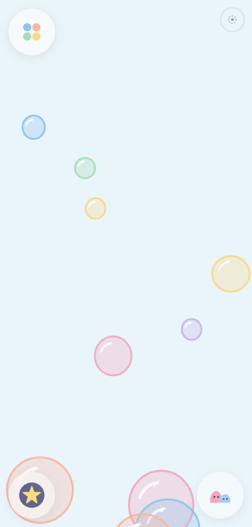
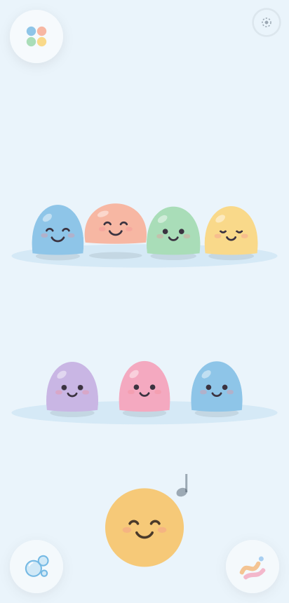
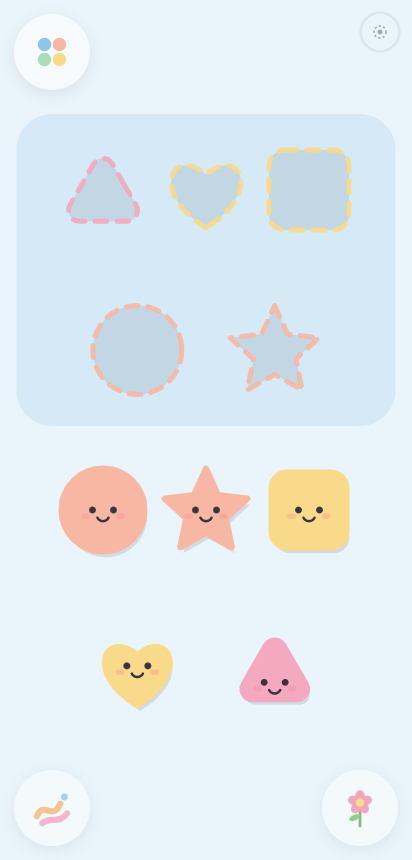
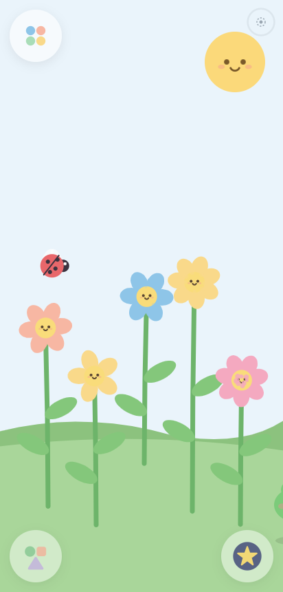
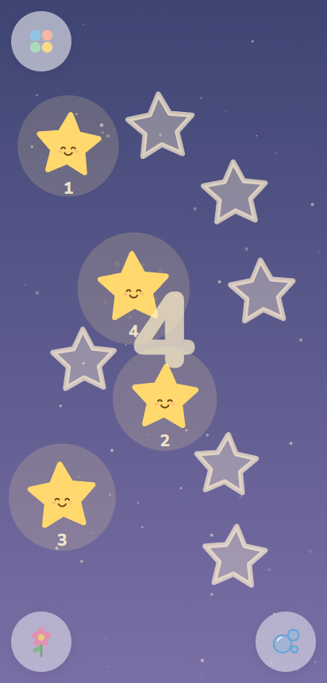
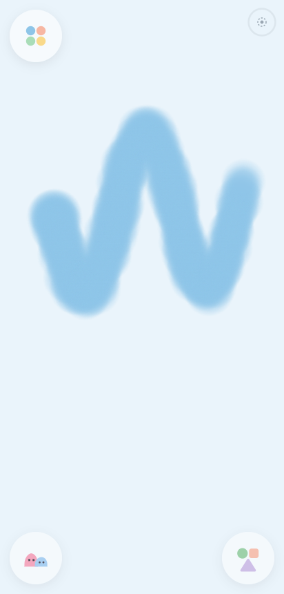
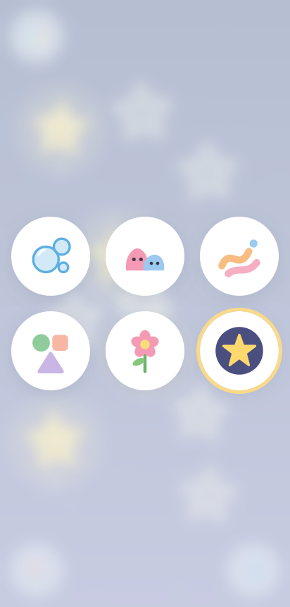

# Blini's Playroom 🫧

A calm, open-ended toy app for little ones (about 1 to 5 years old), plus a separate **Parent Corner** where a grown-up can personalise everything.

No ads. No tracking. No scores, timers or winning and losing. Nothing to read. Works offline. Installs on Android straight from Chrome, with no app store.

**▶ Play it:** https://almakamberi.github.io/blinis-playroom/
**⚙ Parent Corner:** https://almakamberi.github.io/blinis-playroom/parent/
**📖 Setting it up for your child:** [Parents' guide](docs/PARENTS-GUIDE.md)

<p>
  
  
  
  
</p>
<p>
  
  
  
  
</p>

---

## What's inside

### The Playroom (`/`)

Six original toys. Every touch gives a soft sound plus some movement, so no tap is ever "dead". Multi-touch works, so two hands can play at once.

| Toy | What happens | Grows with the child |
|---|---|---|
| **Bubble Pop** | Bubbles float up. Tap one to pop it with a "bloop". Hold on empty space to blow a new bubble that grows under your finger. | Fewer, bigger, slower bubbles for babies |
| **Blob Band** | Friendly jelly blobs, each singing one note. Drag them to rearrange; tap the round conductor to play the row as a little song. | 3 → 5 → 7 blobs |
| **Splash of Colour** | Glowing finger paint that slowly drifts down, spreads and fades away. | Thicker brush for babies |
| **Shape Friends** | Drag smiling shapes into their matching holes. They snap in with a happy wiggle; finish them all for a small celebration and a new round. | 2 → 3 → 5 shapes, bigger snap zone for babies |
| **Little Garden** | Tap to drop seeds. Flowers grow with rising notes; a ladybird and then a frog come to visit. Tap the sun for a breeze. | Faster growth for babies |
| **Counting Stars** | Tap stars to light them up and count. When all are counted they join into a constellation. An optional voice says the numbers. | 1–3 → 1–5 → 1–10 |

Kid-UX rules followed throughout:

- No text the child has to read. The toy menu is icons only.
- Big hit targets (76 px and up).
- Rooms slide gently from one to the next, and the next/previous bubbles show the neighbouring toy's icon.
- After about 30 seconds without a touch, the toy does a tiny, quiet "come play" animation.
- Pull-to-refresh, long-press menus and the Android back gesture are blocked so little hands don't leave by accident.
- All sound comes from **one C-major pentatonic scale**, so any combination of taps sounds pleasant. A volume cap, a soft low-pass filter and a voice limit keep it gentle.
- A **parent gate** guards the only adult element, a faint dotted circle in the top corner: press and hold it for 3 seconds.
- An optional **bedtime fade**: after N minutes the screen dims, the sound fades out and a sleepy Blini appears.

### Parent Corner (`/parent/`)

Protected by a gate: hold a button for 3 seconds, or solve a sum.

| Screen | What you can do |
|---|---|
| **Home** | Child's name and optional photo, "Open Playroom", "Install on this device" |
| **Toys** | Switch toys on or off, drag to reorder, set the level per toy |
| **Look & Sound** | 5 themes (Sky, Peach, Mint, Lavender, Night-calm), sound on/off, volume cap, music style (marimba, chimes, music box), age level ("Grows with your child"), counting voice and language |
| **Time** | Optional gentle play-time limit with a bedtime fade (off by default) |
| **Who can play?** | *Everyone* (default) or *Only my family* (family code), plus **Copy setup link** and a QR code |
| **Install** | Step-by-step "Add to Home screen" help for Android, with a QR code to the Playroom |
| **About & privacy** | A plain-language privacy statement and **Reset to default** |

### Access model

1. **Open by default.** Anyone with the link can play, with no login.
2. **Personalise** in Parent Corner. Settings are saved on the device (`localStorage`).
3. **Share a setup link** (`/?s=…`) so grandparents get the same toys, theme, sounds and rules. The link **never contains the child's name or photo**.
4. **Only my family:** a setup link then asks for a family code the first time it's opened on a new device, and remembers it afterwards.

> **Honest note:** v1 has no server, so the family code is a light lock that keeps casual visitors out. It is not strong security. Accounts and sync are planned for phase 2.

---

## Privacy

- Nothing about the child is collected, tracked or sold. There is no analytics code at all.
- No ads, no in-app purchases, no external links in the playroom.
- Everything is stored in the browser on the device. Clearing site data removes it.
- Fonts are bundled with the app (no Google Fonts request), and sounds are synthesised in the browser. After the first load the app makes no network requests apart from checking for updates.

---

## Tech

- **Vite + React 19 + TypeScript.** No router library: `/` is the Playroom and `/parent/` is Parent Corner.
- **Toys are plain Canvas 2D.** Each toy is a small factory (`src/toys/*.ts`) with `frame / down / move / up / invite` hooks. `ToyCanvas` handles DPR (capped at 2×), resizing, pointer capture for multi-touch and coalesced pointer events. It only animates the room on screen, which keeps it light on low-end phones.
- **Web Audio API** synth (`src/audio/engine.ts`): pentatonic notes with three voicings, a voice cap, a compressor and a low-pass filter. Spoken numbers use the phone's built-in `speechSynthesis`.
- **vite-plugin-pwa / Workbox:** manifest, offline precache of everything (about 480 KB), auto-update, maskable icons.
- **Settings:** one schema with defaults and a `sanitize()` that validates anything read from storage or setup links (`src/settings/`).

```
src/
  main.tsx              picks Playroom or Parent Corner by path
  paths.ts              base-path aware URLs (root hosting or GitHub Pages subfolder)
  pwa.ts                captures the install prompt (only offered in Parent Corner)
  audio/engine.ts       pentatonic synth, volume cap, bedtime fade, number voice
  settings/             schema + defaults, store + setup links, colour themes
  toys/                 one file per toy + ToyCanvas host + helpers
  playroom/             room slider, menu, parent hold, bedtime, family gate
  parent/               Parent Corner gate and screens
  components/           Blini mascot (wave / happy / sleepy), toy icons, hold button
docs/
  PARENTS-GUIDE.md      step-by-step setup for parents
  DESIGN.md             colours, radii, spacing, motion tokens, mascot notes
```

## Run it locally

Needs Node 20 or newer.

```bash
npm install
npm run dev        # http://localhost:5173 (also on your LAN, for testing on a phone)
npm run build      # type-check + production build into dist/
npm run preview    # serve the production build
npm run icons      # regenerate PNG icons from public/icon.svg
```

Tip: service workers and the install prompt need HTTPS (or `localhost`). To test install on a real phone, use the deployed site.

## Deploy

**GitHub Pages (set up already).** Every push to `main` runs [`.github/workflows/deploy.yml`](.github/workflows/deploy.yml). It builds with `BASE_PATH=/blinis-playroom/` and publishes to https://almakamberi.github.io/blinis-playroom/. The build emits `parent/index.html` and `404.html` copies so `/parent/` works without server rewrites.

**Netlify, Vercel or Cloudflare Pages:** build command `npm run build`, output folder `dist`. `public/_redirects` (Netlify) and `vercel.json` already contain the SPA rewrites. Leave `BASE_PATH` unset.

## Acceptance checklist (v1)

- [x] Installs on Android from Chrome (manifest, maskable icons, `display: fullscreen`, service worker)
- [x] Works fully offline after first load (everything precached; sounds are synthesised)
- [x] Zero reading and zero menus needed to play
- [x] Multi-touch on every toy; only the visible room animates
- [x] Settings only reachable through the parent gate
- [x] Open to everyone by default; "Only my family" option
- [x] Rename, theme, toggle and reorder toys, sound, difficulty, copy setup link
- [x] No ads, no tracking, no external links in the playroom
- [x] All art (Blini, toys, icons) and sound are original, drawn and synthesised in code
- [ ] Measured 60 fps with 10+ touches on a real mid-range Android phone. Needs a device test; the canvases are built for it, but it hasn't been measured on hardware yet.
- [ ] Checked on Samsung Internet and a low-end phone

## Roadmap (phase 2)

- Parent accounts and sync across devices (Supabase or Firebase)
- Family voice clips ("Hi!", "Well done!") and Animal Sounds with recorded voices
- Photo Frame: family photos floating in as bubbles
- Busy Board, Lullaby Mode
